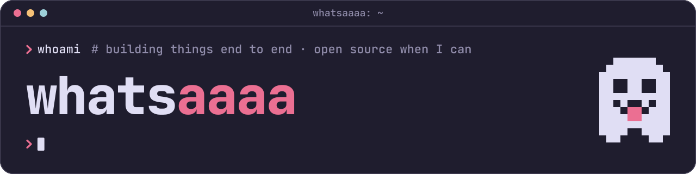

# design-system

Whatsaaaa's design system: one identity, one set of tokens and one voice for the personal site, the docs sites, the apps and the READMEs.

It is not released. The package is private and is not on npm, and the style guide is built here but not deployed.

## What is in it

| Part                    | What it is                                                                                                                      | Source                                    |
| ----------------------- | ------------------------------------------------------------------------------------------------------------------------------- | ----------------------------------------- |
| Identity                | The ghost in every cut, the wordmark, six poses, a sprite per project, favicons, README headers and social cards. All generated | `src/identity/ghost.ts`, `identity/`      |
| Tokens                  | Rosé Pine main for dark and Dawn for light, mapped to roles, with type, space, radii and motion                                 | `tokens/`                                 |
| Styles                  | Prose, code blocks, tables, lists, callouts, and the terminal frame: tab bar, prompts, status line                              | `src/css/`                                |
| The ghost as an element | `<ws-ghost>`, with the easter egg                                                                                               | `src/ghost/`                              |
| Docs theme              | A VitePress theme on top of VitePress's default theme                                                                           | `src/vitepress/`, `src/vitepress-config/` |
| Style guide             | A site that shows all of it with real content, in dark and light, and offers the assets for download                            | `styleguide/`                             |

To use it in another project, read [docs/usage.md](./docs/usage.md). It is written for coding agents and is short.

## Working on it

You need Node.js 24 or later and pnpm. `corepack enable` sets pnpm up.

```sh
pnpm install
pnpm styleguide:dev   # builds the package and starts the style guide
```

| Command                    | What it does                                                                                          |
| -------------------------- | ----------------------------------------------------------------------------------------------------- |
| `pnpm build`               | Builds the package into `dist/`: tokens, fonts, stylesheets and modules                               |
| `pnpm assets`              | Regenerates the asset kit in `assets/` from its sources                                               |
| `pnpm styleguide:dev`      | Starts the style guide                                                                                |
| `pnpm styleguide:build`    | Builds the style guide                                                                                |
| `pnpm test`                | Runs the unit tests, the contrast checks among them                                                   |
| `pnpm test:browser`        | Builds the style guide and runs the browser tests against it. The screenshot tests skip outside Linux |
| `pnpm test:browser:docker` | Runs the browser tests in the Playwright container, screenshots included, as CI does                  |
| `pnpm test:browser:update` | Takes the screenshots again, in the container                                                         |
| `pnpm lint`                | Checks the tokens, the code, the stylesheets and the package                                          |
| `pnpm type-check`          | Type-checks everything                                                                                |
| `pnpm format`              | Formats everything                                                                                    |
| `pnpm contrast`            | Prints the contrast of every pair the system relies on                                                |

Every script builds what it needs first, so each one works on a fresh checkout.

## Changing things

- **A color, a size, a text style.** Edit the files in `tokens/`. They are in the Design Tokens Community Group format and [Terrazzo](https://terrazzo.app) builds them. A color pair that has to stay readable goes in `tokens/contrast.json`, and a test holds it to its bar.
- **The ghost.** Edit `src/identity/ghost.ts`, then run `pnpm assets`. The kit, the element and the style guide all draw from that file.
- **A new project.** Add `identity/projects/<name>.json` with its name, a line about it and its sprite, then run `pnpm assets`.
- **A style.** The stylesheets in `src/css/` take every color from a token. Stylelint rejects a hex value.

Never edit a file in `assets/` or `dist/`. Both are generated, and `assets/` is checked against its sources in CI.

## Checks

CI runs on every pull request:

- formatting, lint and types,
- the unit tests, with the contrast of every role pair in both themes,
- that `assets/` is what the sources produce,
- that the package and the style guide build,
- the browser tests: no page overflows sideways at phone and desktop width in either theme, the easter egg works with the mouse, the keyboard and reduced motion, the keys of the status line work, both fonts draw Serbian Latin, and the pages of the style guide look like their stored screenshots.

The screenshots are in `tests/browser/__screenshots__/` and are taken on Linux, in the Playwright container, so they are the same on every machine. After a change that is meant to be seen, update them:

```sh
pnpm test:browser:update
```

That needs Docker. Review the changed images like any other change. The Playwright version in `package.json` and the container in `.github/workflows/ci.yml` go together: a unit test fails when they differ.

## Layout

```
tokens/          the design tokens, and the contrast pairs
identity/        the handle and one file per project: name, tagline, sprite
src/identity/    the ghost, pixel by pixel, and how a sprite becomes a mark
src/css/         the stylesheets
src/ghost/       <ws-ghost>
src/theme/       the theme switch
src/shortcuts/   keys that click the control they are shown on
src/shiki/       the code theme
src/vitepress/   the docs theme
scripts/         the builds and the asset generator
assets/          the generated asset kit
styleguide/      the style guide
tests/           unit tests, and browser tests in tests/browser/
docs/            the usage guide
licenses/        licenses of what the system builds on
```

## Credits

- Colors are [Rosé Pine](https://rosepinetheme.com), MIT licensed. Its copyright line is kept with the token files.
- [JetBrains Mono](https://www.jetbrains.com/lp/mono/) and [Inter](https://rsms.me/inter/) are under the SIL Open Font License 1.1. The fonts come from Fontsource at build time, and each one is copied into `dist/fonts/` with its license.
- The six letters of the speech bubble are pixel outlines of [Departure Mono](https://departuremono.com), SIL Open Font License 1.1.

The licenses are in [`licenses/`](./licenses/).
