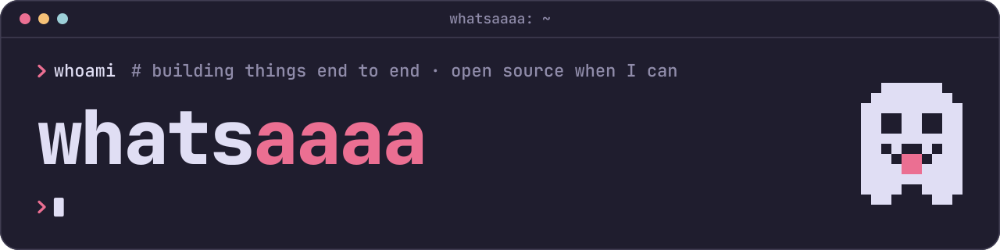

# design-system

Whatsaaaa's design system: one identity, one set of tokens and one voice for the personal site, the docs sites, the apps and the READMEs, and one spec for each component that a library on top of it draws.

The package is [`@whatsaaaa/design-system`](https://www.npmjs.com/package/@whatsaaaa/design-system) on npm. The style guide is at https://whatsaaaa.github.io/design-system/.

## What is in it

| Part                    | What it is                                                                                                                                                                                                                                 | Source                                    |
| ----------------------- | ------------------------------------------------------------------------------------------------------------------------------------------------------------------------------------------------------------------------------------------ | ----------------------------------------- |
| Identity                | The ghost in every cut, the wordmark, six poses, a sprite per project, favicons, README headers, social cards and a profile banner. All generated                                                                                          | `src/identity/ghost.ts`, `identity/`      |
| Tokens                  | Rosé Pine main for dark and Dawn for light, mapped to roles, with type, space, radii and motion, and the component tokens that controls, overlays, tags and tables share                                                                   | `tokens/`                                 |
| Styles                  | Prose, code blocks, tables, lists, callouts, a segmented control, terms and values, and the terminal frame: tab bar, prompts, status line                                                                                                  | `src/css/`                                |
| Component specs         | What every implementation of a component draws alike, as data: its parts, kinds, sizes and states and the token each part takes. Badge, button, card, checkbox, input, modal, radio group, select, select menu, table and tabs so far      | `specs/`                                  |
| Parity helper           | A Playwright helper that holds an implementation's gallery to the specs, in both themes and in forced colors, reading the implementation's own map of the slots that draw each part: `@whatsaaaa/design-system/testing`                    | `src/testing/`                            |
| Token lint rules        | A stylelint config that rejects a hex value, a named color, the color functions `rgb`, `rgba`, `hsl`, `hsla`, `oklch`, `oklab`, `lab`, `lch`, `hwb` and `color`, and a variable that nothing defines: `@whatsaaaa/design-system/stylelint` | `src/stylelint/`                          |
| The ghost as an element | `<ws-ghost>`, with the easter egg                                                                                                                                                                                                          | `src/ghost/`                              |
| Docs theme              | A VitePress theme on top of VitePress's default theme                                                                                                                                                                                      | `src/vitepress/`, `src/vitepress-config/` |
| Style guide             | A site that shows all of it with real content, in dark and light, and offers the assets for download                                                                                                                                       | `styleguide/`                             |

To use it in another project, install it with `pnpm add @whatsaaaa/design-system` and read [docs/usage.md](./docs/usage.md). It is written for coding agents and is short.

What a project can rely on from one version to the next is in [docs/versioning.md](./docs/versioning.md): the public surface, and what is a major, a minor and a patch. The promise starts with 1.0.0. Until then a minor of 0.x may break.

## Working on it

You need Node.js 24.12 or later and pnpm. `corepack enable` sets pnpm up.

```sh
pnpm install
pnpm styleguide:dev   # builds the package and starts the style guide
```

| Command                    | What it does                                                                                                                           |
| -------------------------- | -------------------------------------------------------------------------------------------------------------------------------------- |
| `pnpm build`               | Builds the package into `dist/`: tokens, fonts, stylesheets and modules                                                                |
| `pnpm assets`              | Regenerates the asset kit in `assets/` from its sources                                                                                |
| `pnpm styleguide:dev`      | Starts the style guide                                                                                                                 |
| `pnpm styleguide:build`    | Builds the style guide                                                                                                                 |
| `pnpm test`                | Runs the unit tests, the contrast checks among them                                                                                    |
| `pnpm test:browser`        | Builds the style guide and runs the browser tests against it and an app on the Tailwind entry. The screenshot tests skip outside Linux |
| `pnpm test:browser:docker` | Runs the browser tests in the Playwright container, screenshots included, as CI does                                                   |
| `pnpm test:browser:update` | Takes the screenshots again, in the container                                                                                          |
| `pnpm lint`                | Checks the tokens, the code, the stylesheets and the package                                                                           |
| `pnpm type-check`          | Type-checks everything                                                                                                                 |
| `pnpm format`              | Formats everything                                                                                                                     |
| `pnpm contrast`            | Prints the contrast of every pair the system relies on                                                                                 |
| `pnpm changeset`           | Records a change to the package for the next release                                                                                   |

Every script builds what it needs first, so each one works on a fresh checkout.

## Changing things

- **A color, a size, a text style.** Edit the files in `tokens/`. They are in the Design Tokens Community Group format and [Terrazzo](https://terrazzo.app) builds them. A color pair that has to stay readable goes in `tokens/contrast.json`, and a test holds it to its bar.
- **A component token.** Add it to its group's file in `tokens/components/`, as an alias of a role or a measure. A new group is a new file there and a line in the `components` set of `tokens/whatsaaaa.resolver.json`. `docs/decisions.md` says when a token earns its place, and `tests/tier.test.ts` checks its name and alias.
- **The ghost.** Edit `src/identity/ghost.ts`, then run `pnpm assets`. The kit, the element and the style guide all draw from that file.
- **A new project.** Add `identity/projects/<name>.json` with its name, a line about it and its sprite, then run `pnpm assets`.
- **A style.** The stylesheets in `src/css/` take every color from a token. Stylelint rejects a hex value.
- **A component spec.** Edit `specs/<component>.spec.json`, or add one with its page in `styleguide/components/`. `tests/specs.test.ts` checks it against `specs/spec.schema.json` and the tokens, and the gallery in `tests/fixtures/spec-gallery/` has to meet it, as the browser tests check with the parity helper.

Never edit a file in `assets/` or `dist/`. Both are generated, and `assets/` is checked against its sources in CI.

A pull request that changes what the package ships adds a changeset with `pnpm changeset`. Whether the change is a major, a minor or a patch is in [docs/versioning.md](./docs/versioning.md). See [Releasing](#releasing).

## Checks

CI runs on every pull request:

- formatting, lint and types,
- the unit tests, with the contrast of every role pair in both themes and the comments of the stylesheets in the built ones,
- that `assets/` is what the sources produce,
- that the package and the style guide build,
- the browser tests: no page overflows sideways at phone, tablet and desktop width in either theme, and no terminal window or bar of one cuts off its content, no page logs an error when it loads, the easter egg works with the mouse, the keyboard and reduced motion, the keys of the status line work and their switch turns them off, the numbers of the tabs show only while their keys work and keep their place while the keys load, the current tab keeps its bar in forced colors, in the tab bar and in the docs theme, at phone and desktop width, the icons drawn as masks show in forced colors in the system's color of their text, in the styles, the docs theme and the style guide, and the docs theme's theme switch, menu button and search button in the color of a button's text, with their focus ring, the path of the status line gives way at every width from 320 px without leaving a stub, and in the docs theme from 180 px with the keys on and 187 px with them off, its items take less padding on a phone and the theme button switches the theme, the content of a window starts at the gutter where the brand of the tab bar does on a phone, in the docs theme too, where a project's mark as the logo starts on it as well and over the sidebar's headings from 60rem up, a `dark` or `light` class chooses the theme as `data-theme` does, an element for one theme shows only in it, the browser's theme-color follows the theme and the page as it is sent has it for both themes, without JavaScript, a control that takes the focus is not left under the status line and no bar or corner of the window cuts off its focus ring, a button of the docs theme takes its ring and not the browser's and the ring of its brand paints over neither the mark nor the name, a code group's language stands in the row of its tabs and off its code, inline code breaks at no hyphen in a word at any width from 320 px, a package path only after a slash, and copies as it is, a radius of the page's own wins over the focus ring's and a button without one takes its small corners, with index.css and with tailwind.css, a state lines up with the text beside it, a prompt that wraps keeps its chevron on its first line at every width from 320 px, assistive technology reads the parts of the path above a page title as words of their own, the first tab starts on the border of the sidebar, the pieces of a form fit every width from 320 px (a segmented control works with the keyboard, stands out at 3:1 and takes the selection colors in forced colors, amounts line up at the right in figures of one width, the sections of a review share a term column, two fields share a row from 40rem, a number field has no spin buttons and its arrow keys step it, wrapped code hangs and stays inside its block, a long email breaks after its @, and the icons draw at the icon size and the ghost files draw), both fonts draw Serbian Latin, the parity helper passes a gallery of plain HTML that meets every published spec, its table and tabs on a screen of two device pixels to a CSS pixel too, and fails one with a drifted value, a missing example, a part no example draws, a checked option drawn in the wrong fill, a list's edge drawn as a ring, an outlined badge drawn as a ring in the padding of a tint, an edge lost in forced colors, or a checked box, a selected row or a current tab that forced colors hide, though the row is drawn at another fraction of a pixel and the tab's bar outside its box, as Nuxt UI draws it, with the current tab's panel under the row, the separator of a select's list shows in forced colors, where a fill would not, the system's own tag meets the badge spec, an app built on the Tailwind entry takes its utilities, layers and `dark:` and `light:` from the tokens and their theme, and the pages of the style guide look like their stored screenshots.

The screenshots are in `tests/browser/__screenshots__/` and are taken on Linux, in the Playwright container, so they are the same on every machine. After a change that is meant to be seen, update them:

```sh
pnpm test:browser:update
```

That needs Docker. Review the changed images like any other change. The Playwright version in `package.json` and the `playwright-version` in `.github/workflows/ci.yml`, the tag of the container CI runs the browser tests in, go together: a unit test fails when they differ.

## Releasing

1. A pull request that changes what the package ships adds a changeset with `pnpm changeset`, with the bump [docs/versioning.md](./docs/versioning.md) gives the change.
2. When it merges, the release workflow, `.github/workflows/release.yml`, opens a Version Packages pull request that bumps the version and writes the changelog.
3. Merging that one starts the publish job. It waits for a reviewer to approve the `npm` environment.
4. Once approved, it publishes to npm through trusted publishing, with provenance. No npm token is stored anywhere.

That needs:

- an `npm` environment in the repository, with a required reviewer,
- "Allow GitHub Actions to create and approve pull requests" turned on in the repository's Actions settings, so the workflow can open its pull request,
- a trusted publisher on the package's npm settings: GitHub Actions, repository `whatsaaaa/design-system`, workflow `release.yml`, environment `npm`, allowed to publish,
- a public repository, since npm records provenance only for a public one.

npm sets up a trusted publisher only for a package that exists, so the package was first created on npm with a hand-published 0.0.0 placeholder before trusted publishing was configured.

## Layout

```
tokens/          the design tokens, the component tier in components/, and the contrast pairs
specs/           the component specs, and the schema they are checked against
identity/        the handle and one file per project: name, tagline, sprite
src/identity/    the ghost, pixel by pixel, and how a sprite becomes a mark
src/css/         the stylesheets
src/ghost/       <ws-ghost>
src/theme/       the theme switch
src/shortcuts/   keys that click the control they are shown on, and their switch
src/shiki/       the code theme
src/testing/     the parity helper, and how a spec's examples are read
src/stylelint/   the token lint rules, which this repository's stylelint config extends
src/vitepress/   the docs theme
scripts/         the builds and the asset generator
assets/          the generated asset kit
styleguide/      the style guide
tests/           unit tests, and browser tests in tests/browser/
docs/            the usage guide, the versioning policy, the decisions behind the build, and follow-ups
licenses/        licenses of what the system builds on
```

## Credits

- Colors are [Rosé Pine](https://rosepinetheme.com), MIT licensed. Its copyright line is kept with the token files.
- [JetBrains Mono](https://www.jetbrains.com/lp/mono/) and [Inter](https://rsms.me/inter/) are under the SIL Open Font License 1.1. The fonts come from Fontsource at build time, and each one is copied into `dist/fonts/` with its license.
- The six letters of the speech bubble are pixel outlines of [Departure Mono](https://departuremono.com), SIL Open Font License 1.1.

The licenses are in [`licenses/`](./licenses/).

## License

Everything made for Whatsaaaa here is [MIT](./LICENSE), the identity artwork included: the tokens, the stylesheets, the component specs, the scripts, `<ws-ghost>`, the theme, shortcut and code-theme modules, the parity helper, the token lint rules, the docs theme, and the ghost, the wordmark, the lockups and marks, the sprite and mark of each project, the README headers, the social cards, the profile banner and the favicons.

The third-party material in the [credits](#credits) keeps its own license: the Rosé Pine palette is MIT, and the Departure Mono glyph outlines and the JetBrains Mono and Inter fonts are under the SIL Open Font License 1.1.
